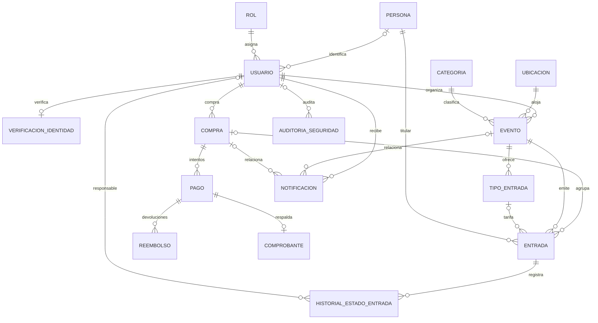

# Butaca

Plataforma académica de gestión de eventos y venta de entradas nominales desarrollada con **Spring Boot 4 (Java 17)**, **Spring Data JPA**, **PostgreSQL / H2** y **React + Vite**.

---

## Arquitectura y Modelo de Datos (3FN)

El modelo relacional está normalizado en **Tercera Forma Normal (3FN)** y compuesto por **16 entidades** distribuidas en **5 módulos**:

1. **Identidad y Autenticación:** `persona`, `usuario`, `rol`, `verificacion_identidad`
2. **Eventos y Notificaciones:** `categoria`, `ubicacion`, `evento`, `notificacion`
3. **Compras, Tarifas y Entradas:** `compra`, `tipo_entrada`, `entrada`, `historial_estado_entrada`
4. **Pagos, Reembolsos y Comprobantes:** `pago`, `reembolso`, `comprobante`
5. **Seguridad y Auditoría Forense:** `auditoria_seguridad`



### Decisiones de Diseño Clave

- **Separación de Identidad (`persona` vs `usuario`):** Los datos filiatorios (`dni_persona`, nombre y apellido) residen una única vez en `persona`. Esto permite emitir entradas nominales para acompañantes sin cuenta y evita duplicar el DNI en `verificacion_identidad` o `entrada`.
- **Tarifario e Histórico de Precios (`tipo_entrada` y `entrada`):** Los precios de lista se configuran en `tipo_entrada`, mientras que cada ticket emitido congela su valor en `entrada.precio_pagado_entrada`.
- **Sin Columnas Calculadas:** El cupo disponible de un evento, la cantidad de entradas y el monto total de una compra se calculan dinámicamente a partir de `entrada`.
- **Pagos y Comprobantes:** `pago` registra la transacción de pasarela sin almacenar datos sensibles de tarjeta (PAN/CVV). `comprobante` se vincula `1:1` al pago aprobado mediante firma criptográfica `SHA-256` (`hash_cruce_seguridad`), y `reembolso` registra devoluciones ante cancelaciones.
- **Trazabilidad y Concurrencia:** Control de concurrencia optimista (`@Version`) en `evento` y `entrada`, historial de estados por ticket en `historial_estado_entrada` y bitácora *append-only* en `auditoria_seguridad`.

---

## Requisitos Previos

- **Java 17+** (`JAVA_HOME` configurado)
- **Node.js 20.19+ / 22.12+** y **pnpm 9+**

---

## Ejecución Local

### 1. Backend (Spring Boot + Base H2 en memoria)

```powershell
.\mvnw.cmd spring-boot:run
```

- **API REST:** `http://localhost:8081/api/eventos`
- **Consola H2:** `http://localhost:8081/h2-console`
  - **JDBC URL:** `jdbc:h2:mem:butaca_demo`
  - **Usuario:** `sa` *(contraseña vacía)*

### 2. Frontend (React + Vite)

```powershell
cd frontend
pnpm install
pnpm run dev
```

- **Aplicación Web:** `http://localhost:5173`

### 3. Pruebas Automatizadas

```powershell
.\mvnw.cmd test
```

---

## Usuarios de Prueba (`DataLoader`)

| Rol | Email | Contraseña | Permisos Principales |
| --- | --- | --- | --- |
| **Cliente** | `cliente@butaca.com` | `cliente123` | Catálogo, verificación KYC, compra de entradas nominales y descarga de tickets QR. |
| **Organizador** | `org@butaca.com` | `org123` | Creación y edición de eventos, gestión de tarifas, publicación, cancelación y validación de QR en puerta. |
| **Administrador** | `admin@butaca.com` | `admin123` | Gestión de ubicaciones, categorías, roles de usuario y auditoría de seguridad. |

---

## Endpoints Principales de la API REST

### Autenticación e Identidad (KYC)
- `POST /api/auth/register` — Registro de usuario.
- `POST /api/auth/login` — Inicio de sesión.
- `GET /api/verificaciones/usuario/{usuarioId}` — Estado de verificación KYC del usuario.
- `POST /api/verificaciones` — Solicitud y validación de identidad KYC.

### Eventos y Catálogo
- `GET /api/eventos` — Listado de eventos publicados con cupo disponible.
- `GET /api/eventos/{id}` — Detalle de un evento y sus tarifas (`tipos_entrada`).
- `POST /api/eventos` / `PUT /api/eventos/{id}` — Creación y actualización de eventos y tarifas.
- `PUT /api/eventos/{id}/publicar` — Publicación de evento en estado `BORRADOR`.
- `PUT /api/eventos/{id}/cancelar` — Cancelación de evento, anulación de entradas y generación automática de reembolsos.

### Compras, Entradas y Notificaciones
- `POST /api/compras` — Compra transaccional (validación KYC, control de cupo, registro de pago, emisión de entradas nominales, comprobante SHA-256, notificación y auditoría).
- `GET /api/compras/{id}` / `GET /api/compras/usuario/{id}` / `GET /api/compras/organizador/{id}` — Consulta de compras.
- `GET /api/entradas/validar/{codigo}` — Validación de código único QR en puerta.
- `PUT /api/entradas/{id}/usar` — Registro de ingreso nominal (`CONFIRMADA` → `USADA`).
- `GET /api/notificaciones/usuario/{usuarioId}` / `PUT /api/notificaciones/{id}/leer` — Bandeja de notificaciones.

### Administración y Auditoría
- `GET /api/admin/dashboard` / `GET /api/admin/stats` — Indicadores generales y operaciones cruzadas.
- `GET /api/admin/usuarios` / `PUT /api/admin/usuarios/{id}/rol` — Administración de usuarios y roles.
- `GET /api/admin/auditoria` — Consulta de la bitácora `auditoria_seguridad`.
- `GET /api/admin/categorias` / `POST /api/admin/categorias` — Gestión de categorías.
- `GET /api/admin/ubicaciones` / `POST /api/admin/ubicaciones` — Gestión de ubicaciones.

---

## Documentación Técnica

- [`srs_proyecto.md`](srs_proyecto.md) — Especificación de Requisitos de Software (SRS).
- [`docs/schema-3fn-seguridad.sql`](docs/schema-3fn-seguridad.sql) — DDL PostgreSQL exportado desde DrawDB.
- [`docs/drawdb-butaca-modelado-datos.json`](docs/drawdb-butaca-modelado-datos.json) — Diagrama completo de DrawDB (16 tablas, 5 módulos y notas técnicas).
- [`docs/normalizacion-base-datos.md`](docs/normalizacion-base-datos.md) — Justificación de normalización (1FN, 2FN y 3FN).
