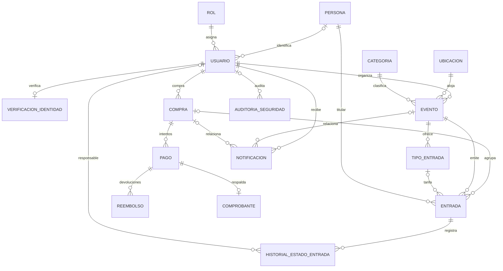

# Butaca — Plataforma de Gestión de Eventos y Venta de Entradas Nominales

> Estado de la revisión (24/10/2026): demo académica con API real y modelo de 16 entidades. KYC y pasarela siguen simulados; el correo tiene transporte SMTP real, configurable mediante una cuenta remitente local. La autorización de la API por sesión/rol y la restricción del registro público siguen pendientes; no usar para ventas reales. [Correo real y panel de eventos](docs/correo-real-y-eventos.md).

Sistema web académico (**Spring Boot + React + JPA**) para gestionar espectáculos y ventas simuladas. Modela verificación de identidad, pagos, entradas nominales con QR, comprobantes con hash SHA-256 y trazabilidad de operaciones. Las integraciones y la autorización necesarias para un uso real están detalladas en la revisión.

---

## 📚 Documentación y Diagramas del Proyecto

- 📊 **Diagrama Entidad-Relación Editable (Draw.io):** [`diagrama Butaca.drawio`](diagrama%20Butaca.drawio) / [`diagrama Butaca.drawio.xml`](diagrama%20Butaca.drawio.xml)
- 🗂️ **Modelo DBML (dbdiagram.io):** [`butaca.dbml`](butaca.dbml)
- 📐 **Justificación de 1FN, 2FN, 3FN y Seguridad:** [`docs/normalizacion-base-datos.md`](docs/normalizacion-base-datos.md)
- 📖 **Glosario de las 13 Tablas y Preguntas de Defensa:** [`docs/glosario-y-modelo-base-de-datos.md`](docs/glosario-y-modelo-base-de-datos.md)
- 🎤 **Plan de Exposición de 10 Minutos:** [`docs/plan-exposicion-10-minutos.md`](docs/plan-exposicion-10-minutos.md)
- 🧭 **Guía Rápida de Presentación y Consultas SQL H2:** [`docs/guia-presentacion.md`](docs/guia-presentacion.md)
- 📋 **Especificación de Requisitos de Software (SRS):** [`srs_proyecto.md`](srs_proyecto.md)

---

## Funcionalidades de demo y requisitos del proyecto

1. **Verificación de Identidad Obligatoria antes de Comprar (`verificacion_identidad`):**
   - Ningún usuario puede adquirir entradas sin haber validado previamente su identidad (**KYC** mediante validación biométrica/documental simulada con RENAPER).
   - Cumple con la **Ley 25.326 de Protección de Datos Personales**: no almacena fotos crudas del rostro ni del DNI, sino el estado (`VERIFICADA`), el método empleado y el token de validación (`codigo_validacion_kyc`).
2. **Pasarela de Pago Integrada al Modelo bajo PCI-DSS (`pago`):**
   - Modela el procesamiento con pasarelas (`MERCADOPAGO`, `STRIPE`, `MODO`) y medios de pago (`TARJETA_CREDITO`, `TARJETA_DEBITO`, `BILLETERA_VIRTUAL`).
   - Cumple estrictamente **PCI-DSS**: jamás persiste los 16 dígitos de la tarjeta (PAN) ni el código CVV; únicamente almacena los `ultimos_cuatro_digitos` y el token `referencia_externa_pago`.
3. **Método Transaccional de Cruce de Información (`CompraService.comprarEntrada`):**
   - Operación atómica (`@Transactional`) que cruza en tiempo real:
     1. Identidad `VERIFICADA` del comprador (`verificacion_identidad`).
     2. Disponibilidad real del espectáculo y control de concurrencia con bloqueo optimista `@Version` (`evento`).
     3. Aprobación del cobro en la pasarela (`pago`).
     4. Emisión de tickets nominales individuales (`entrada` + `historial_estado_entrada`).
     5. Generación del comprobante electrónico con **firma criptográfica SHA-256** (`comprobante`) y envío de confirmación (`notificacion`).
     6. Registro de auditoría en la bitácora de seguridad (`auditoria_seguridad`).
4. **Entrada Nominal Óptima (`entrada`):**
   - Cada ticket individual emitido posee `codigo_unico_entrada` (QR), `nombre_asistente_entrada` y `dni_asistente_entrada`.
   - Permite que un comprador verificado compre entradas para sí mismo y acompañantes asignando el nombre y DNI real de cada asistente, erradicando la reventa y habilitando el **control en puerta por QR + DNI físico**.
5. **Trackeo de Datos e Inmutabilidad (`auditoria_seguridad` + `historial_estado_entrada`):**
   - Bitácora doble *append-only*: `historial_estado_entrada` audita cada cambio de estado de cada ticket (`CONFIRMADA`, `USADA`, `ANULADA`), mientras que `auditoria_seguridad` registra logins, verificaciones KYC, compras aprobadas/bloqueadas, cambios de rol y lecturas en puerta con fecha/hora e IP.
6. **Separación de Vistas y Permisos por Rol (Principio de Mínimo Privilegio):**
   - **Registro público (requisito pendiente de protección):** Debe crear únicamente `CLIENTE` y tramitar la habilitación de organizador desde administración. Actualmente el backend acepta el rol del request; ver pendientes de seguridad de la revisión.
   - **Vista Cliente:** Muestra un checkout limpio (validación biométrica RENAPER + tarjeta interactiva) y entradas listas para presentar en puerta, ocultando hashes técnicos internos.
   - **Vista Organizador:** Incluye validador de acceso en puerta (**Escáner QR + verificación de DNI nominal**) y gestión de eventos propios.
   - **Vista Administrador:** Permite gestionar usuarios, promover cuentas a `ORGANIZADOR` y auditar la tabla de cruce técnico de compras (`SHA-256`, tokens de pasarela y bitácora de seguridad).

---

## 🗄️ Modelo vigente: 16 entidades en 3FN

Fuente editable: [DrawDB — butaca-modelado-datos](https://drawdb.leandro754.moe/editor/diagrams/butaca-modelado-datos).
La revisión del 24/10/2026 verificó presencia y nombres de columnas contra las 16 entidades JPA.
Los archivos Draw.io/DBML y guías de defensa anteriores son material histórico; no deben usarse como DDL vigente sin contrastarlos con DrawDB.



La identidad civil reside en `persona`; la tarifa, en `tipo_entrada`.
Cada entrada conserva su precio y moneda históricos y referencia a la persona titular.
Cantidad, total y disponibilidad son valores calculados. `comprobante` referencia a `pago`, sin duplicar comprador ni compra.

---

## 🔄 ¿Cómo interactúa la Página Web con el Diagrama paso a paso?

### 1. Registro de Usuario (`/registro`)
1. El usuario completa sus datos en la web.
2. `AuthService` consulta **`ROL`** para asignar obligatoriamente el rol `CLIENTE` (impidiendo escalamiento de privilegios desde el formulario público).
3. Se persiste el usuario en **`USUARIO`** con su contraseña cifrada mediante `BCrypt`.
4. Se graba el alta en **`AUDITORIA_SEGURIDAD`** (`accion_auditoria = REGISTRO_USUARIO`).

### 2. Navegación y Filtro por Categorías (`/` y `/buscar?categoria=...`)
1. Al abrir el catálogo o usar el menú desplegable **Categorías** del Navbar, el frontend consulta `GET /api/eventos`.
2. `EventoService` une **`EVENTO`** con **`CATEGORIA`** y **`UBICACION`** (obteniendo dirección y capacidad sin redundancia 3FN) y calcula el cupo disponible restando las filas activas (`CONFIRMADA` y `USADA`) en **`ENTRADA`**.

### 3. Verificación de Identidad Obligatoria KYC (`/checkout/:eventoId` — Paso 1)
1. Antes de habilitar el pago, el checkout consulta `GET /api/verificacion-identidad/usuario/{id}` sobre **`VERIFICACION_IDENTIDAD`**.
2. Si el usuario aún no está verificado, completa el asistente biométrico/documental (RENAPER).
3. `VerificacionIdentidadService` valida que el `dni_usuario` no pertenezca a otra cuenta en **`USUARIO`**, crea o actualiza la fila en **`VERIFICACION_IDENTIDAD`** con `estado_verificacion = VERIFICADA` y `codigo_validacion_kyc`, y registra la validación en **`AUDITORIA_SEGURIDAD`**.

### 4. Método de Cruce de Información al Comprar (`POST /api/compras` — Pasos 2 y 3)
Al presionar **"FINALIZAR LA COMPRA"**, `CompraService.comprarEntrada()` ejecuta una **única transacción ACID (`@Transactional`)** que recorre **8 tablas**:
1. **Cruce de Identidad:** Comprueba en **`USUARIO`** y **`VERIFICACION_IDENTIDAD`** que la cuenta esté `ACTIVO` y `VERIFICADA`. Si no cumple, aborta la compra y registra `CRUCE_COMPRA_BLOQUEADO` en **`AUDITORIA_SEGURIDAD`**.
2. **Cruce de Stock y Concurrencia:** Bloquea optimistamente la fila en **`EVENTO`** (`@Version`) y cuenta en **`ENTRADA`** que existan butacas disponibles.
3. **Cabecera Comercial:** Inserta la orden en **`COMPRA`** (`estado_compra = CONFIRMADA`).
4. **Pasarela de Pago (PCI-DSS):** Procesa el cobro y registra en **`PAGO`** la `pasarela_pago`, `medio_pago`, `referencia_externa_pago` y solo los `ultimos_cuatro_digitos` (`estado_pago = APROBADO`).
5. **Emisión de Entradas Nominales:** Por cada asistente, inserta una fila en **`ENTRADA`** con su `codigo_unico_entrada` (UUID), `nombre_asistente_entrada`, `dni_asistente_entrada` y `precio_pagado_entrada`, y crea su primer registro en **`HISTORIAL_ESTADO_ENTRADA`**.
6. **Comprobante con SHA-256 y envío:** Calcula el hash de integridad, guarda el recibo en **`COMPROBANTE`** y el trabajo en **`NOTIFICACION`**, ambos pendientes. Un trabajador posterior al commit envía por SMTP las entradas nominales PNG con QR y el recibo; marca enviado únicamente después de aceptación por SMTP.
7. **Trackeo de Seguridad:** Registra el cruce exitoso en **`AUDITORIA_SEGURIDAD`** (`CRUCE_COMPRA_EXITOSO`).

### 5. Validación en Puerta por el Organizador (`/organizador`)
1. El organizador ingresa el código QR del ticket y el DNI físico presentado por el asistente en la puerta.
2. `EntradaService.usarEntrada()` busca el ticket en **`ENTRADA`**, verifica que esté `CONFIRMADA` y **compara el `dni_asistente_entrada` nominal con el DNI presentado**.
3. Si coinciden, actualiza **`ENTRADA`** a `USADA`, inserta la transición en **`HISTORIAL_ESTADO_ENTRADA`** (`CONFIRMADA -> USADA`) y registra la lectura en **`AUDITORIA_SEGURIDAD`**. Si el DNI no coincide o el QR ya fue utilizado, rechaza el ingreso y audita la anomalía.

---

## 🛡️ Cumplimiento de Formas Normales y Seguridad Informática

| Criterio | Implementación en Butaca |
| --- | --- |
| **1FN (Atómico)** | Cada atributo contiene un único valor atómico. Una compra de $N$ entradas genera $N$ filas independientes en `entrada`, cada una con su propio titular, DNI y QR. |
| **2FN (Dependencia Funcional Completa)** | Todas las tablas poseen clave primaria simple (`BIGINT`) y sus atributos dependen íntegramente de dicha clave. |
| **3FN y FNBC (Sin Dependencias Transitivas)** | • `rol`, `categoria` y `ubicacion` están separados en tablas maestras.<br>• `compra` no duplica cantidad ni monto total (se calculan desde `entrada.precio_pagado_entrada`).<br>• `pago` y `comprobante` no duplican el monto ni el `id_cliente` (se obtienen por `JOIN` con `compra` y `entrada`).<br>• `evento` no persiste `cupos_disponibles` como columna redundante. |
| **PCI-DSS (Seguridad en Medios de Pago)** | Jamás se almacena el PAN completo (16 dígitos) ni el CVV. Solo se persisten `ultimos_cuatro_digitos` y el token `referencia_externa_pago`. |
| **Integridad Criptográfica** | Contraseñas hasheadas con `BCrypt` y comprobantes sellados con `SHA-256` (`hash_cruce_seguridad`). |
| **Control de Concurrencia** | Bloqueo optimista `@Version` en `Evento` (`OPTIMISTIC_FORCE_INCREMENT`) dentro de transacciones `@Transactional` para impedir sobreventa. |

---

## 🚀 Requisitos y Ejecución Rápida

### Requisitos
- **Java 17** (`JAVA_HOME` configurado)
- **Node.js >= 20** y **pnpm** (solo si se desea recompilar el frontend; el build estático ya está incluido en `src/main/resources/static`)

### Opción 1: Iniciar en Windows con doble clic (Modo Demo H2)
Ejecutar el archivo [`iniciar-windows.bat`](iniciar-windows.bat) o desde PowerShell:

```powershell
.\mvnw.cmd spring-boot:run "-Dspring-boot.run.profiles=demo"
```

Una vez iniciado, abrir en el navegador:
- **Aplicación Web Completa:** `http://localhost:8080`
- **API REST:** `http://localhost:8080/api`
- **Consola Base de Datos H2:** `http://localhost:8080/h2-console`
  - **JDBC URL:** `jdbc:h2:mem:butaca_demo`
  - **User Name:** `sa`
  - **Password:** *(dejar vacío)*

### Opción 2: Levantar Backend (8080) + Frontend con Hot-Reload (5173)
```powershell
powershell -ExecutionPolicy Bypass -File .\scripts\demo.ps1
```

### 🔑 Credenciales de Prueba Precargadas (`DataLoader`)

| Rol | Email | Contraseña | Qué permite probar |
| --- | --- | --- | --- |
| **Cliente** | `cliente@butaca.com` | `cliente123` | Explorar catálogo, filtrar por categorías, verificar identidad KYC (RENAPER), comprar entradas nominales y ver mis tickets QR. |
| **Organizador** | `org@butaca.com` | `org123` | Mis eventos, métricas y configuración por evento: fecha, cupo, tarifas, publicación y cancelación con doble confirmación. |
| **Administrador** | `admin@butaca.com` | `admin123` | Gestionar ubicaciones y categorías, **cambiar roles de usuarios (`CLIENTE` ↔ `ORGANIZADOR`)** y auditar la tabla técnica de cruce de compras (`SHA-256`, pasarela y bitácora). |

---

## 🔌 Endpoints Principales de la API REST

### Autenticación e Identidad (KYC)
- `POST /api/auth/register` — Registro público de cuentas `CLIENTE`.
- `POST /api/auth/login` — Inicio de sesión con validación `BCrypt`.
- `GET /api/verificaciones/usuario/{usuarioId}` — Consulta estado KYC del usuario.
- `POST /api/verificaciones` — Ejecuta la validación KYC simulada antes de comprar.

### Catálogo y Eventos
- `GET /api/eventos` — Lista eventos publicados con disponibilidad calculada.
- `GET /api/eventos/{id}` — Detalle de un espectáculo.
- `POST /api/eventos` / `PUT /api/eventos/{id}` — Creación y edición por organizador. Admiten `tipos_entrada`: lista de `{id_tipo_entrada?, nombre, descripcion?, precio, activo}` (1 a 20, al menos una activa); edición admite `version` para detectar un formulario desactualizado. Las respuestas incluyen tarifas, `entradas_vendidas`, `total_vendido`, `porcentaje_ocupacion` y la versión optimista real.
- `PUT /api/eventos/{id}/publicar` / `PUT /api/eventos/{id}/cancelar` — Ciclo de vida del evento. Cancelar requiere JSON `{"confirmar_reembolsos":true,"titulo_confirmacion":"Título exacto","version":0}`; usar la versión actual de GET, no un valor fijo. Un evento cancelado no se puede republicar ni editar.

### Compras, Pasarela de Pago y Entradas Nominales
- `POST /api/compras` — **Método transaccional de cruce de información** (KYC + Stock `@Version` + Pago PCI-DSS + Emisión Nominal + Comprobante `SHA-256` + Notificación + Auditoría).
- `GET /api/compras/{id}` / `GET /api/compras/usuario/{id}` / `GET /api/compras/organizador/{id}`
- `GET /api/entradas/validar/{codigo}` — Consulta estado y titularidad nominal de un QR en puerta.
- `PUT /api/entradas/{id}/usar` — Consume la entrada. El formulario coteja DNI; la comprobación de DNI/propiedad en backend sigue pendiente.

### Administración y Auditoría de Seguridad
- `GET /api/admin/dashboard` / `GET /api/admin/stats` — Métricas e historial de compras cruzadas.
- `GET /api/admin/usuarios` / `PUT /api/admin/usuarios/{id}/rol` — Gestión de cuentas y asignación del rol `ORGANIZADOR`.
- `GET /api/admin/auditoria` — Bitácora inmutable de seguridad (`auditoria_seguridad`).
- `GET /api/admin/categorias` / `POST /api/admin/categorias`
- `GET /api/admin/ubicaciones` / `POST /api/admin/ubicaciones`

---

## 🧪 Ejecución de Pruebas Automatizadas

```powershell
.\mvnw.cmd test
```

Las pruebas de integración en [`ButacaApplicationTests.java`](src/test/java/com/demo/butaca/ButacaApplicationTests.java) verifican automáticamente:
1. Filtrado del catálogo público por disponibilidad real.
2. Bloqueo de seguridad cuando un usuario intenta comprar sin verificación de identidad KYC.
3. Cruce transaccional completo de compra (emisión de entradas nominales con DNI por asistente, pago PCI-DSS, comprobante con hash `SHA-256`, incremento de `@Version` e historial).
4. Persistencia del modelo normalizado y generación de reembolsos al cancelar eventos. La suite actual no prueba autorización por rol, DNI en backend ni carreras de concurrencia.

## Interfaz y verificación del frontend

La identidad vigente sigue la referencia cinematográfica de Butaca: marca SVG con B roja y pochoclos, titulares condensados, hero amplio y paleta roja/carbón/marfil. Incluye intro en cada apertura o recarga, sin repetición en navegación interna, con salto y respeto por movimiento reducido. El favicon muestra el isotipo original y la pestaña se titula «Butaca · Más eventos para vos». [Recursos y secuencia de apertura](docs/identidad-y-apertura.md).

El inicio presenta cuatro recomendados de categorías variadas en un carrusel automático de 7 segundos, con pausa al interactuar, navegación manual y deslizamiento en móvil. La cartelera combina categoría, orden de fecha y accesos «Próximos 7 días», «Este finde» y «Este mes», con carga progresiva de tarjetas y animaciones breves que respetan movimiento reducido.

El perfil `demo` agrega 14 eventos ficticios de seis categorías desde `src/main/resources/demo-events.tsv`. Para incorporarlos a una demo ya abierta sin reiniciar la base H2, ejecutar desde la raíz `./scripts/seed-demo-events.ps1` (API predeterminada `http://localhost:8081/api`; configurable con `-ApiBaseUrl`). Repetir el comando conserva los eventos existentes y no duplica la semilla.

El inicio prioriza los eventos; los paneles separan tareas en secciones. Agenda, ventas y actividad incluyen búsqueda, rangos inclusivos de fechas, orden ascendente/descendente y paginación local. El cliente puede ordenar por fecha del evento o de compra y descargar QR generados localmente, también sin conexión al generador externo.

```powershell
cd frontend
pnpm run build
node --test src/utils/collectionFilters.test.js src/utils/qrCode.test.js
```

`VITE_API_BASE_URL` conserva el fallback `http://localhost:8080/api`. Para usar el proxy de Vite, configurar `VITE_API_BASE_URL=/api` y `VITE_API_PROXY_TARGET=http://localhost:PUERTO` en un archivo local ignorado `frontend/.env.local`. En este equipo el backend existente usa 8081; el proxy estándar sigue apuntando a 8080 si no se configura otra cosa.

Para activar Gmail, ejecutar `./scripts/configure-mail.ps1` desde PowerShell: pide las credenciales localmente, envía una prueba real y guarda `secrets/mail.properties`, ignorado por Git. Reiniciar el backend para activar la cola. El configurador fija el destino de prueba directamente en la cuenta Gmail elegida y la dirección de respuesta en `contact@leandro754.moe`, evitando el reenvío de Cloudflare hacia el mismo remitente. Se admite `-TestRecipient` para elegir otro destino. [Configuración, estados y límites](docs/correo-real-y-eventos.md).

`POST /api/compras` admite `tipo_entrada_id` opcional; si se omite, utiliza la tarifa activa de menor precio. El backend valida evento, tarifa y disponibilidad y congela el precio real en las entradas. `POST /api/notificaciones` admite `compra_id` opcional y las respuestas muestran `estado_envio`.

El organizador accede a una sola agenda en `/dashboard` y al panel por evento en `/dashboard/eventos/:eventId`. El modo oscuro se controla desde la cabecera y cambia con un telón rojo; respeta movimiento reducido.
