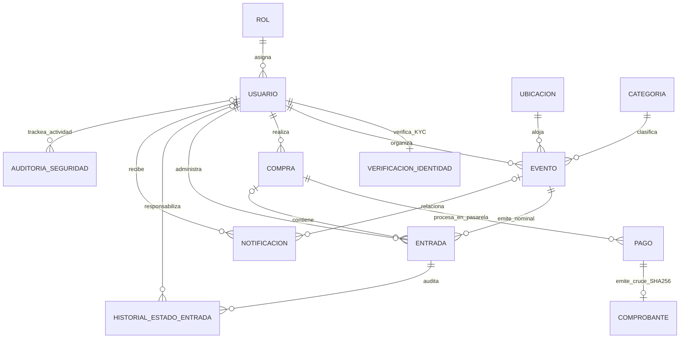

# Glosario y Explicación del Modelo de Base de Datos (13 Tablas en 3FN) - Butaca

> **Alcance de la demo:** la pasarela de pago y el proveedor KYC son simulados. El proyecto no afirma certificación PCI-DSS ni integración real con RENAPER; las referencias a PCI-DSS describen minimización de datos, no una certificación.

Este documento proporciona el **glosario conceptual**, la **justificación de diseño relacional (3FN)** y las **respuestas técnicas estructuradas** para defender y explicar el modelo de datos y la seguridad informática del proyecto ante el docente o evaluador.

El esquema canónico formal se encuentra definido en [`butaca.dbml`](../butaca.dbml).

---

## 1. Diagrama Entidad-Relación y Estructura Global

---

## 2. Glosario de Entidades (13 Tablas del Sistema)

### 1. `rol` (Catálogo de perfiles)
* **Propósito**: Define los niveles de acceso del sistema (`ADMIN`, `ORGANIZADOR`, `CLIENTE`).
* **Columnas principales**: `id_rol` (PK), `nombre_rol` (UNIQUE, CHECK).
* **Justificación 3FN**: Desacoplar los roles evita escribir cadenas de texto duplicadas en la tabla de usuarios y garantiza integridad referencial.

### 2. `usuario` (Cuentas, DNI y credenciales)
* **Propósito**: Almacena las cuentas de acceso, documento de identidad único (`dni_usuario`), datos personales y estado operativo.
* **Columnas principales**: `id_usuario` (PK), `id_rol` (FK), `nombre_usuario`, `apellido_usuario`, `dni_usuario` (UNIQUE), `email_usuario` (UNIQUE), `password_hash_usuario`, `estado_usuario` (`ACTIVO`, `INACTIVO`, `SUSPENDIDO`).
* **Justificación de Seguridad**: La contraseña se guarda hasheada con BCrypt (salted hash) y jamás se expone en los DTOs de respuesta de la API REST.

### 3. `verificacion_identidad` (Validación KYC obligatoria antes de comprar)
* **Propósito**: Acredita la identidad real de un usuario antes de permitirle comprar entradas.
* **Columnas principales**: `id_verificacion` (PK), `id_usuario` (FK UNIQUE), `metodo_verificacion` (`BIOMETRIA_RENAPER`, `DOCUMENTO_DNI`, `OTP_EMAIL`), `estado_verificacion` (`PENDIENTE`, `VERIFICADA`, `RECHAZADA`), `codigo_validacion_kyc` (UNIQUE), `observacion_verificacion`, `hash_evidencia_documental`, `hash_selfie`, `proveedor_identidad`, `puntaje_coincidencia`, `fecha_solicitud`, `fecha_verificacion`.
* **Justificación 3FN y Seguridad (Ley 25.326)**: No repite `dni_usuario` ni `nombre_usuario` (que ya están en `usuario`). Aplica minimización de datos: guarda hashes SHA-256 de las evidencias, proveedor, puntaje y token de validación, pero no las imágenes biométricas ni documentales crudas.

### 4. `ubicacion` (Recintos físicos)
* **Propósito**: Representa los lugares físicos donde se llevan a cabo los espectáculos.
* **Columnas principales**: `id_ubicacion` (PK), `nombre_ubicacion`, `direccion_ubicacion`, `capacidad_maxima_ubicacion`, `activa_ubicacion`.
* **Justificación 3FN**: Evita duplicar nombre, dirección y aforo en cada evento.

### 5. `categoria` (Clasificación de eventos)
* **Propósito**: Catálogo temático para organizar la cartelera (Conciertos, Teatro, Deportes, Festivales).
* **Columnas principales**: `id_categoria` (PK), `nombre_categoria` (UNIQUE), `descripcion_categoria`.

### 6. `evento` (Publicación del espectáculo)
* **Propósito**: Ficha pública de un espectáculo creada por un organizador.
* **Columnas principales**: `id_evento` (PK), `id_organizador` (FK), `id_ubicacion` (FK), `id_categoria` (FK), `titulo_evento`, `fecha_evento`, `hora_evento`, `precio_actual_entrada`, `cupo_total_evento`, `estado_evento`, `version_evento` (`@Version`).
* **Sin datos calculados (3FN)**: No almacena `cupos_disponibles` como columna física persistida.

### 7. `compra` (Cabecera de transacción comercial)
* **Propósito**: Registra la operación comercial entre un comprador con identidad verificada y el sistema.
* **Columnas principales**: `id_compra` (PK), `id_cliente` (FK), `fecha_compra`, `estado_compra` (`PENDIENTE`, `CONFIRMADA`, `CANCELADA`).
* **Sin redundancias (3FN)**: No almacena `id_evento`, `cantidad` ni `total`. Esos datos derivan de las entradas asociadas a la compra.

### 8. `pago` (Pasarela de Pago desacoplada con minimización de datos)
* **Propósito**: Registra el procesamiento del cobro a través de una pasarela externa.
* **Columnas principales**: `id_pago` (PK), `id_compra` (FK), `pasarela_pago` (`MERCADOPAGO`, `STRIPE`, `MODO`, `DEBITO_TOKENIZADO`), `medio_pago` (`TARJETA_CREDITO`, `TARJETA_DEBITO`, `TRANSFERENCIA_CVU`, `DINERO_CUENTA`), `estado_pago` (`PENDIENTE`, `APROBADO`, `RECHAZADO`, `REEMBOLSADO`), `referencia_externa_pago` (UNIQUE), `ultimos_cuatro_digitos`, `monto_pago`, `moneda_pago`, `codigo_autorizacion_pago`, `fecha_pago`.
* **Justificación 3FN y minimización**: La cantidad y el total de la compra se derivan de las entradas. `monto_pago` es un hecho externo: el importe autorizado por la pasarela, que se cruza contra esa suma. No se almacena el número completo de tarjeta (PAN) ni el CVV; solo referencias, últimos cuatro dígitos y datos de autorización. Esto sigue buenas prácticas de PCI-DSS, pero no constituye una certificación de cumplimiento.

### 9. `comprobante` (Cruce de Información, Firma SHA-256 y Envío Digital)
* **Propósito**: Respalda fiscal y criptográficamente el cruce exitoso entre identidad verificada, pago aprobado y emisión/envío de entradas.
* **Columnas principales**: `id_comprobante` (PK), `id_pago` (FK UNIQUE), `numero_comprobante` (UNIQUE), `tipo_comprobante` (`RECIBO_DIGITAL`, `FACTURA_B`, `FACTURA_C`), `hash_cruce_seguridad` (UNIQUE, SHA-256), `estado_envio_comprobante` (`PENDIENTE`, `ENVIADO`, `ERROR_ENVIO`), `fecha_emision_comprobante`.
* **Justificación 3FN**: Al vincularse a `id_pago` (que a su vez referencia a `id_compra`), evita dependencias transitivas hacia `id_compra` o `id_cliente`.

### 10. `entrada` (Ticket individual y Nominal por Asistente)
* **Propósito**: Representa cada pase digital individual y nominal emitido.
* **Columnas principales**: `id_entrada` (PK), `codigo_unico_entrada` (UUID único para QR), `id_evento` (FK), `id_cliente` (FK), `id_compra` (FK nullable), `dni_asistente_entrada`, `nombre_asistente_entrada`, `precio_pagado_entrada`, `estado_entrada` (`CONFIRMADA`, `USADA`, `ANULADA`), `fecha_validacion_entrada`, `version_entrada` (`@Version`).
* **Nominalidad e inmutabilidad histórica**: Cada ticket registra el DNI y nombre del asistente real que ingresará al evento (`dni_asistente_entrada`, `nombre_asistente_entrada`) y congela el `precio_pagado_entrada`.

### 11. `historial_estado_entrada` (Trazabilidad del ciclo de vida del ticket)
* **Propósito**: Registro cronológico de los cambios de estado de cada ticket (emisión con número de comprobante, ingreso nominal en puerta, anulación).
* **Columnas principales**: `id_historial_entrada` (PK), `id_entrada` (FK), `estado_anterior_entrada`, `estado_nuevo_entrada`, `id_usuario_responsable` (FK nullable), `motivo_cambio_entrada`, `fecha_cambio_entrada`.

### 12. `notificacion` (Mensajería interna y avisos de envío)
* **Propósito**: Mensajes operativos enviados a los usuarios ante eventos relevantes (verificación KYC exitosa, envío de comprobante y entradas nominales, cancelación de evento).
* **Columnas principales**: `id_notificacion` (PK), `id_usuario_destinatario` (FK), `id_evento_relacionado` (FK nullable), `mensaje_notificacion`, `tipo_notificacion`, `leida_notificacion`.

### 13. `auditoria_seguridad` (Bitácora inmutable de Tracking e Informática)
* **Propósito**: Registra eventos de seguridad y operaciones críticas. Los servicios la usan como bitácora de inserciones (*append-only*); esto no implica certificación ISO 27001 ni una garantía de inmutabilidad frente a acceso directo a la base.
* **Columnas principales**: `id_auditoria` (PK), `id_usuario` (FK nullable), `accion_auditoria`, `entidad_afectada`, `id_registro_afectado`, `resultado_auditoria` (`EXITOSO`, `RECHAZADO`, `BLOQUEADO`), `ip_origen`, `detalle_tracking`, `fecha_auditoria`.

---

## 3. Respuestas Rápidas para Defender ante el Profesor

### Pregunta 1: ¿Cómo funciona el método que cruza la información al comprar la entrada?
> **Respuesta**:
> "En `CompraService.comprarEntrada` implementamos una transacción atómica (`@Transactional`) que cruza 6 verificaciones encadenadas:
> 1. **Verificación de identidad (KYC)**: Comprueba que el usuario tenga estado `VERIFICADA` en `verificacion_identidad`. Si no está verificado, bloquea la compra y lo registra en `auditoria_seguridad`.
> 2. **Stock y Concurrencia**: Bloquea el `evento` con `@Version` y valida disponibilidad real.
> 3. **Pasarela de Pago**: Procesa el pago mediante `PagoGateway` (simulado en la demo), valida monto y moneda, y registra la referencia externa y los últimos 4 dígitos.
> 4. **Emisión Nominal**: Crea cada `entrada` con su UUID y el DNI y nombre del asistente asignado.
> 5. **Comprobante y Firma Criptográfica SHA-256**: Genera el `comprobante` asociado al `pago`, calculando un hash SHA-256 sobre el ID de compra, DNI del comprador, token KYC, referencia de pago y UUIDs de las entradas, y marca el envío digital como `ENVIADO` junto con la notificación.
> 6. **Tracking**: Audita el cambio en `historial_estado_entrada` y en `auditoria_seguridad`."

### Pregunta 2: ¿Por qué `comprobante` se relaciona con `pago` y no repite `id_compra` ni `id_cliente`?
> **Respuesta**:
> "Para cumplir estrictamente con la **Tercera Forma Normal (3FN)**. Como cada comprobante corresponde a un pago aprobado (`comprobante.id_pago -> pago.id_pago`), y cada pago pertenece a una única compra (`pago.id_compra -> compra.id_compra`), la compra y el cliente ya se determinan transitivamente. Si agregáramos `id_compra` o `id_cliente` en `comprobante`, tendríamos una dependencia transitiva ($id\_comprobante \to id\_pago \to id\_compra \to id\_cliente$) y riesgo de inconsistencia."

### Pregunta 3: ¿Por qué la entrada nominal por asistente es el diseño más óptimo?
> **Respuesta**:
> "Porque resuelve simultáneamente la seguridad física, la experiencia de usuario y la 3FN:
> * El comprador está obligado a verificar su identidad en la app (`verificacion_identidad`) antes de comprar.
> * Al comprar varios tickets en una misma operación, asigna el DNI y nombre de cada asistente en cada fila de `entrada`.
> * Esto facilita que el personal compare el QR (`codigo_unico_entrada`) con el DNI físico. El dato nominal por sí solo no impide la reventa; el control actual de DNI es visual."
