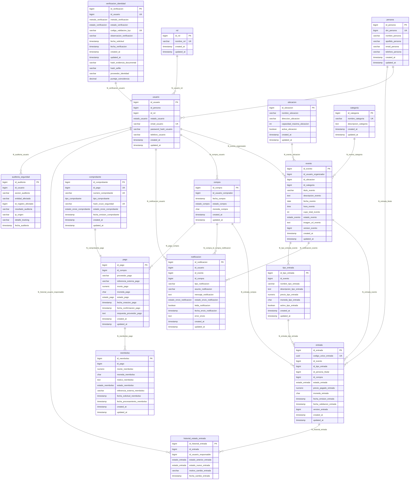

# Verificación de Normalización (1FN, 2FN, 3FN y BCNF) y Seguridad Informática - Butaca

> **Alcance de la demo:** la pasarela de pago y el proveedor de identidad son simulados. El proyecto no afirma certificación PCI-DSS ni integración real con RENAPER; las referencias a PCI-DSS describen decisiones de minimización de datos, no una certificación.

Este documento detalla el modelo relacional implementado en **Butaca** (16 entidades), con las decisiones de diseño trabajadas para la entrega académica:
1. **Verificación de Identidad Obligatoria antes de comprar (KYC)** (`verificacion_identidad` + `persona.dni_persona`).
2. **Pasarela de Pago desacoplada con minimización de datos inspirada en PCI-DSS** (`pago`).
3. **Método de Cruce de Información al comprar (Verificación + Pago + Envío de Entrada + Comprobante con firma SHA-256)** (`comprobante` + `CompraService.comprarEntrada`).
4. **Entradas Nominales por Asistente** (`persona.dni_persona`, `persona.nombre_persona`).
5. **Tracking y Auditoría de Datos de Seguridad Informática** (`auditoria_seguridad` + `historial_estado_entrada`).

El archivo gráfico editable en DBML es [`butaca.dbml`](../butaca.dbml) y el diagrama DrawDB de referencia es [`docs/drawdb-butaca-modelado-datos.json`](drawdb-butaca-modelado-datos.json).

---

## 1. Diagrama Entidad-Relación (Mermaid ER Completo en 3FN)

Podés copiar este bloque `erDiagram` directamente en **Draw.io** (`Organizar -> Insertar -> Avanzado -> Mermaid...`) o visualizarlo en GitHub/Markdown:

---

## 2. Normalización y datos históricos

La identidad civil pertenece a `persona`. `usuario` contiene credenciales y referencias a persona y rol; los acompañantes pueden tener una persona titular sin crear una cuenta.

Cada evento referencia una ubicación y una categoría. Las tarifas residen en `tipo_entrada`; los precios actuales se separan de los históricos que conserva cada `entrada`. El DNI y el nombre que devuelve el DTO del ticket se proyectan desde su persona titular.

Una compra agrupa filas de entrada. Cantidad, total y cupo disponible se calculan desde esas filas. El monto de pago se conserva porque es el importe externo autorizado, que debe coincidir con la suma de entradas.

El comprobante referencia al pago, por el que se recuperan compra y comprador. Los reembolsos se vinculan al pago. No se duplican compra ni cliente en comprobante.

Las claves primarias simples evitan dependencias parciales de una clave compuesta. La separación entre persona, cuenta, tarifa, transacción y comprobante reduce dependencias transitivas. La normalización debe revisarse con las dependencias funcionales del dominio; la presencia de un ID por tabla no demuestra por sí sola 3FN o BCNF.

## 3. Compra, integridad y concurrencia

La compra exige usuario activo, KYC verificado y datos coherentes del comprador. Valida asistentes, disponibilidad y tarifa del evento; procesa el pago mediante el adaptador simulado y contrasta monto y moneda.

En una transacción guarda compra, pago, tickets, historial, comprobante y notificación pendiente. El hash SHA-256 usa la fecha, comprador, token KYC, monto y referencia del pago, UUIDs y titulares. El endpoint de cruce recalcula esa representación con los datos persistidos. No constituye una firma digital certificada.

Evento y entrada usan `@Version` para detectar escrituras concurrentes. Las pruebas de tarifas comprueban que editar el precio de catálogo no cambia el histórico. Queda pendiente ampliar pruebas concurrentes y de carga.

## 4. Evidencias, envío y auditoría

La implementación integra cuatro campos de evidencia KYC en `verificacion_identidad`: hashes SHA-256 de documento y selfie, proveedor y puntaje. Las imágenes se procesan en memoria y no se guardan. El snapshot DrawDB se conserva como referencia; el DBML y el DDL locales incluyen estas extensiones.

Pago no guarda PAN ni CVV. Su respuesta reducida conserva medio, últimos cuatro dígitos y código de autorización; monto y moneda tienen una sola columna cada uno.

El trabajador de correo opera después del commit. Sin SMTP configurado, la notificación sigue pendiente; una aceptación SMTP habilita el estado enviado. Un fallo de correo no revierte la compra.

Historial de entrada y auditoría registran operaciones de dominio y seguridad. Los rechazos usan transacciones independientes para conservar evidencia. La aplicación no demuestra certificación PCI-DSS, ISO 27001 ni inmutabilidad frente a un administrador de base.

El control nominal de DNI es visual y la autorización de la API mediante sesión y rol sigue pendiente. KYC, pasarela y reembolsos son simulados; SMTP es real solo cuando se habilita.
